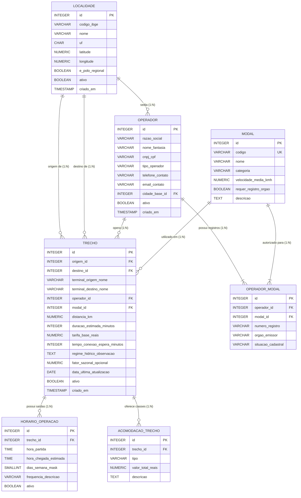
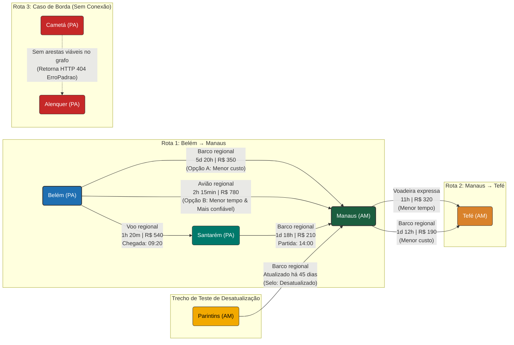
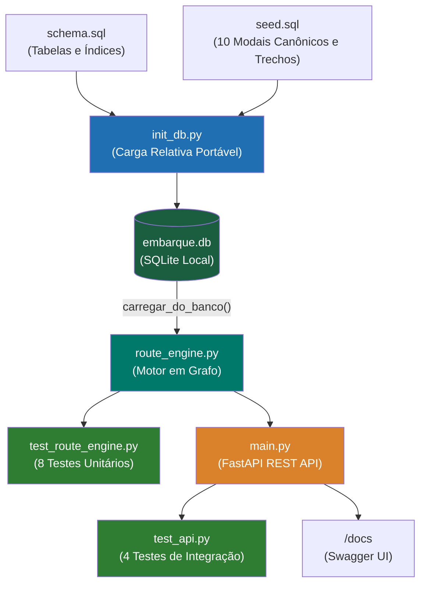

# 🗄️ Diagramas da Camada de Banco de Dados (`database/`)
**Projeto Integrado II • Embarque Amazônia (CESUPA)**

---

## 1. Diagrama Entidade-Relacionamento (ERD)

Este diagrama reflete fielmente o arquivo [`schema.sql`](file:///D:/Users/Kzar/Documents/Faculdade/Projeto%20Integrado%20II/database/schema.sql) normalizado:

---

## 2. Diagrama de Topologia do Grafo e Rotas Canônicas

O arquivo [`seed.sql`](file:///D:/Users/Kzar/Documents/Faculdade/Projeto%20Integrado%20II/database/seed.sql) popula os nós e arestas que formam a malha de teste:

---

## 3. Diagrama do Fluxo de Inicialização e Consumo dos Dados

Visualização de como [`init_db.py`](file:///D:/Users/Kzar/Documents/Faculdade/Projeto%20Integrado%20II/database/init_db.py) garante a integridade e alimenta a API e os testes:

