# EMBARQUE AMAZÔNIA — PROJETO INTEGRADO II
## Módulo 2: Mapa de Navegação e Inventário Detalhado das 16 Telas
**Responsável:** César Augusto Borges Ribeiro (Coordenação Geral)  
**Público-Alvo das Telas:** Passageiros Ribeirinhos/Urbanos e Operadores/Cadastradores de Transportes  
**Atualização:** 11/11/2026  

---

### 1. MAPA DE NAVEGAÇÃO CONCEITUAL (PROTÓTIPO NO FIGMA)

O sistema é concebido no Figma em dois fluxos visuais: o **Fluxo do Passageiro (Mobile 360×800 px)** e o **Fluxo de Cadastro Administrativo (Desktop 1440×1024 px)**.

```mermaid
flowchart TD
    subgraph FLUXO_PASSAGEIRO ["Fluxo do Passageiro (Mobile 360×800)"]
        P01["P01 - Home / Busca Rápida"]
        P02["P02 - Seletor de Localidade (Origem / Destino)"]
        P03["P03 - Filtros e Preferências Multimodais"]
        P04["P04 - Lista de Resultados de Rotas"]
        P05["P05 - Comparador de Rotas (Lado a Lado)"]
        P06["P06 - Detalhe Completo da Rota"]
        P07["P07 - Detalhe Específico do Trecho"]
        P08["P08 - Mapa Interativo da Rota"]
        P09["P09 - Rotas Salvas & Consulta Offline"]
        P10["P10 - Estados do Sistema (Sem Rota / Erro / Carregando)"]

        P01 -->|Tocar em Origem/Destino| P02
        P02 -->|Localidade Selecionada| P01
        P01 -->|Tocar em Filtrar| P03
        P03 -->|Aplicar Critérios| P04
        P01 -->|Buscar Rotas| P04
        
        P04 -->|Selecionar mais de 1 rota| P05
        P04 -->|Tocar no Card de Rota| P06
        P06 -->|Tocar em Trecho da Timeline| P07
        P06 -->|Tocar em 'Ver no Mapa'| P08
        
        P01 -->|Menu Inferior: 'Salvas'| P09
        P06 -->|Salvar para Offline| P09
        
        P04 -.->|Sem Conexão ou Sem Trecho| P10
        P09 -.->|Visualização em Trânsito| P10
    end

    subgraph FLUXO_CADASTRO ["Fluxo de Cadastro / Operador (Desktop 1440×1024)"]
        A01["A01 - Login / Autenticação do Operador"]
        A02["A02 - Painel Geral de Gestão de Trechos"]
        A03["A03 - Formulário de Cadastro/Edição de Trecho"]
        A04["A04 - Cadastro e Vínculo de Operador"]
        A05["A05 - Cadastro de Localidade"]
        A06["A06 - Confirmação e Resumo"]

        A01 -->|Credenciais Válidas| A02
        A02 -->|Botão: 'Novo Trecho'| A03
        A02 -->|Botão: 'Gerenciar Operadores'| A04
        A02 -->|Botão: 'Localidades'| A05
        
        A03 -->|Submeter Formulário| A06
        A04 -->|Submeter Formulário| A06
        A05 -->|Submeter Formulário| A06
        
        A06 -->|Retornar ao Painel| A02
    end
```

---

### 2. INVENTÁRIO DAS 16 TELAS (COM DELIMITAÇÃO DE MVP vs. FORA DO MVP)

Os critérios oficiais de ordenação do MVP são **Menor tempo**, **Menor custo** e **Mais confiável** (baseado na recência da atualização). Itens de concepção visual não cobertos pelo MVP estão explicitamente sinalizados abaixo.

#### 📱 BLOCO 1: PASSAGEIRO — BUSCA E RESULTADOS (Telas P01 a P04)
* **Responsável no Figma:** Herbert | **Resolução:** Mobile `360 × 800 px` | **Página Figma:** `02_Passageiro`

| ID | Nome da Tela | Objetivo e Escopo | Componentes da UI e Classificação no MVP |
|:---:|---|---|---|
| **P01** | **Home / Busca Rápida** | Entrada principal de consulta origem → destino. | **MVP:** Campos Origem/Destino, seletor de data, critério, botão Buscar. **Fora do MVP:** Aba/módulo "Avisos" e card dinâmico de alertas sazonais em tempo real. |
| **P02** | **Escolher Localidade** | Localizar cidades, portos ou aeroportos por busca textual. | **MVP:** Campo de busca (`GET /api/v1/localidades?busca=`) com nome, UF e tipo/código IATA. **Fora do MVP:** Abas específicas e buscas recentes persistidas em servidor. |
| **P03** | **Filtros e Preferências** | Selecionar critério e modais permitidos. | **MVP:** Critérios oficiais (**Menor tempo**, **Menor custo**, **Mais confiável**) e switches dos 10 modais canônicos. **Fora do MVP:** Critério "Menos Transbordos", filtro de conforto avançado e toggle de alerta severo de estiagem. |
| **P04** | **Lista de Resultados** | Exibir opções ordenadas (até 5 opções). | **MVP:** Cards com modais, preço em BRL, duração, conexões, selos (`Menor tempo`, `Menor custo`, `Mais confiável`, `Desatualizado`) e recência em dias. **Fora do MVP:** Horário previsto de chegada calculado e alerta dinâmico de conexão curta em tempo real. |

---

#### 📱 BLOCO 2: PASSAGEIRO — DETALHES, MAPA E ESTADOS (Telas P05 a P10)
* **Responsável no Figma:** Lucas | **Resolução:** Mobile `360 × 800 px` | **Página Figma:** `02_Passageiro`

| ID | Nome da Tela | Objetivo e Escopo | Componentes da UI e Classificação no MVP |
|:---:|---|---|---|
| **P05** | **Comparar Opções** | Comparar 2 a 3 rotas lado a lado. | **MVP:** Preço, duração, número de conexões, modais e recência. **Fora do MVP:** Score numérico de risco de atraso por sazonalidade. |
| **P06** | **Detalhe da Rota** | Timeline dos trechos componentes da rota. | **MVP:** Trechos em sequência (operador, terminais, duração, tarifa), tempo de conexão entre trechos e ação de salvar rota. **Fora do MVP:** Ponto de transbordo como entidade física autônoma. |
| **P07** | **Detalhe do Trecho** | Inspecionar dados operacionais do trecho. | **MVP:** Operador, terminais, duração, tarifa, horários e observação textual de regime hídrico. **Fora do MVP:** Política de carga rural estruturada e ligação direta automatizada. |
| **P08** | **Mapa da Rota** | Visualização simplificada do trajeto. | **MVP:** Referência visual com base nos terminais/localidades quando coordenadas estiverem cadastradas. **Fora do MVP:** **Mapa vetorial interativo com camada completa de hidrografia amazônica** e pins com baldeação a pé/moto-táxi. |
| **P09** | **Rotas Salvas / Offline** | Acesso a rotas previamente salvas no aparelho. | **MVP:** Salvamento local em IndexedDB indexado pelo ID determinístico da rota (`rota-t{ids}`). **Fora do MVP:** **"Hash de integridade"** criptográfico e sincronização automática em segundo plano. |
| **P10** | **Estados do Sistema** | Tratamento de carregando, erro e vazio. | **MVP:** Estados de carregamento, lista vazia (`200 OK`, `rotas: []`, ex.: Cametá → Alenquer) e erro amigável de rede/API. **Fora do MVP:** Variação de "Alerta de Vazante Crítica" por telemetria ao vivo. |

---

#### 💻 BLOCO 3: CADASTRO ADMINISTRATIVO E GESTÃO DE DADOS (Telas A01 a A06)
* **Responsável no Figma:** Fernando | **Resolução:** Desktop `1440 × 1024 px` | **Página Figma:** `03_Cadastro`

| ID | Nome da Tela | Objetivo e Escopo | Componentes da UI e Classificação no MVP |
|:---:|---|---|---|
| **A01** | **Login Administrativo** | Autenticação de operadores e administradores. | **MVP (Semana 2):** Login por credenciais e JWT (`bearerAuth` no `openapi.yaml`). **Fora do MVP:** Portal público automatizado de credenciamento de cooperativas. |
| **A02** | **Painel Geral de Trechos** | Listagem administrativa e manutenção de trechos. | **MVP (Semana 2):** Tabela via `GET /api/v1/trechos` e ações de novo trecho/operador/localidade. **Fora do MVP:** Aba/painel "Alertas Sazonais" com telemetria e exportação analítica avançada. |
| **A03** | **Cadastro de Trecho** | Inserção/edição de trecho na malha (`POST /api/v1/trechos`). | **MVP (Semana 2):** Origem, destino, operador, modal, sentido, horários/dias, acomodações (rede/camarote) e observação de regime. **Fora do MVP:** Fator numérico automático de atraso por seca somado à duração. |
| **A04** | **Cadastro de Operador** | Registro de empresa, cooperativa ou piloto (`POST /api/v1/operadores`). | **MVP (Semana 2):** Razão social, nome fantasia, tipo, órgão regulador/registro e modais operados (`operador_modal`). **Fora do MVP:** **Upload de arquivos comprovantes de outorga** e integração direta com WhatsApp. |
| **A05** | **Cadastro de Localidade** | Mapeamento de localidades atendidas. | **MVP (Semana 2):** Nome, UF, código IBGE/IATA e tipo de localidade. **Fora do MVP:** **Vínculo de transbordo / Ponto de Transbordo** como entidade relacional própria com distância em metros entre portos. |
| **A06** | **Confirmação e Auditoria** | Confirmação do cadastro salvo e atualização no motor. | **MVP (Semana 2):** Feedback de criação e recarga idempotente do grafo. **Fora do MVP:** Cálculo automático prévio de quantas novas combinações o trecho viabilizou. |

---

### 3. DADOS DE REFERÊNCIA E IDENTIDADE VISUAL

* Os dados de exemplo ilustrativos usados no banco, na API e na interface estão unificados em [`database/seed.sql`](../database/seed.sql) e [`docs/escopo_requisitos.md`](escopo_requisitos.md) (Rotas 1, 2 e 3: **Belém → Manaus**, **Manaus → Tefé** e **Cametá → Alenquer**). Exemplos antigos do esboço inicial no Figma (*Breves → Camará → Belém*) não fazem parte da base executável e estão arquivados como referência conceitual.
* A identidade visual segue o Kit de Estilo definido em [`docs/escopo_requisitos.md`](escopo_requisitos.md) (fonte **Inter**, primária `#1B5E3F`, secundária `#1F6FB2`, categorias de modais e cores dos selos).

---

### 4. ESTADO DE IMPLEMENTAÇÃO ATUAL

* **Protótipo no Figma:** Todas as **16 telas** (`P01–P10` e `A01–A06`) existem hoje apenas como especificação visual/protótipo no Figma.
* **Implementação em código (`web/`):** Existe no repositório **apenas uma tela funcional inicial de busca e listagem de resultados** (consumindo `GET /api/v1/localidades` e `GET /api/v1/rotas` da API FastAPI, com formatação em pt-BR, selos coloridos, recência em dias e expansão de trechos).
* **Pendências previstas para a Semana 2:** Endpoints CRUD/autenticação na API, implementação das telas P01–P10 e A01–A06 no `web/` e camada offline em IndexedDB — detalhadas no mapeamento campo a campo em [`docs/telas_x_api.md`](telas_x_api.md).
