# EMBARQUE AMAZÔNIA — PROJETO INTEGRADO II
## Módulo 2: Mapa de Navegação e Inventário Detalhado das 16 Telas
**Responsável:** César Augusto Borges Ribeiro (Coordenação Geral)  
**Card Trello de Referência:** [https://trello.com/c/QCtkJrPE](https://trello.com/c/QCtkJrPE)  
**Público-Alvo das Telas:** Passageiros Ribeirinhos/Urbanos e Operadores/Cadastradores de Transportes  
**Data:** 28/10/2026  

---

### 1. MAPA DE NAVEGAÇÃO INTEGRADO (DIAGRAMA DE FLUXO)

O sistema divide-se em dois macroambientes: o **Fluxo do Passageiro (Mobile 360×800)**, voltado para consulta rápida, comparação e visualização offline; e o **Fluxo de Cadastro Administrativo (Desktop 1440×1024)**, voltado para a alimentação dos trechos, operadores e alertas hidrológicos.

```mermaid
flowchart TD
    subgraph FLUXO_PASSAGEIRO ["Fluxo do Passageiro (Mobile 360×800)"]
        P01["P01 - Home / Busca Rápida"]
        P02["P02 - Seletor de Localidade (Origem / Destino)"]
        P03["P03 - Filtros e Preferências Multimodais"]
        P04["P04 - Lista de Resultados de Rotas"]
        P05["P05 - Comparador de Rotas (Lado a Lado)"]
        P06["P06 - Detalhe Completo da Rota"]
        P07["P07 - Detalhe Específico do Trecho"]
        P08["P08 - Mapa Interativo da Rota"]
        P09["P09 - Rotas Salvas & Consulta Offline"]
        P10["P10 - Estados do Sistema (Offline/Sem Rota/Aviso)"]

        P01 -->|Tocar em Origem/Destino| P02
        P02 -->|Localidade Selecionada| P01
        P01 -->|Tocar em Filtrar| P03
        P03 -->|Aplicar Critérios| P04
        P01 -->|Buscar Rotas| P04
        
        P04 -->|Selecionar mais de 1 rota| P05
        P04 -->|Tocar no Card de Rota| P06
        P06 -->|Tocar em Trecho da Timeline| P07
        P06 -->|Tocar em 'Ver no Mapa'| P08
        
        P01 -->|Menu Inferior: 'Salvas'| P09
        P06 -->|Salvar para Offline| P09
        
        P04 -.->|Sem Conexão ou Sem Trecho| P10
        P09 -.->|Visualização em Trânsito| P10
    end

    subgraph FLUXO_CADASTRO ["Fluxo de Cadastro / Operador (Desktop 1440×1024)"]
        A01["A01 - Login / Autenticação do Operador"]
        A02["A02 - Painel Geral de Gestão de Trechos"]
        A03["A03 - Formulário de Cadastro/Edição de Trecho"]
        A04["A04 - Cadastro e Vínculo de Operador"]
        A05["A05 - Cadastro de Localidade & Ponto de Transbordo"]
        A06["A06 - Confirmação, Auditoria e Feedback"]

        A01 -->|Credenciais Válidas| A02
        A02 -->|Botão: 'Novo Trecho'| A03
        A02 -->|Botão: 'Gerenciar Operadores'| A04
        A02 -->|Botão: 'Pontos & Transbordos'| A05
        
        A03 -->|Submeter Formulário| A06
        A04 -->|Submeter Formulário| A06
        A05 -->|Submeter Formulário| A06
        
        A06 -->|Retornar ao Dashboard| A02
    end
```

---

### 2. INVENTÁRIO MINUCIOSO DAS 16 TELAS

---

#### 📱 BLOCO 1: PASSAGEIRO — MÓDULO DE BUSCA E RESULTADOS (Telas P01 a P04)
* **Responsável no Figma:** Hebert  
* **Resolução:** Mobile Android (360 × 800 px)  
* **Página Figma:** `02_Passageiro`  

| ID | Nome da Tela | Objetivo do Usuário | Componentes Chave da UI | Transições e Ações |
|:---:|---|---|---|---|
| **P01** | **Home / Busca Rápida** | Ponto de entrada do passageiro para definir rota desejada e acessar atalhos. | - Barra superior com logo *Embarque Amazônia* e indicador de conectividade. - Inputs táteis para "De onde você sai?" e "Para onde quer ir?". - Seletor rápido de data da viagem. - Botão de inversão de sentido (🔄). - Botão primário com ícone de lupa: "Calcular Rotas". - Card de aviso contextual sobre vazante dos rios. - Barra inferior de navegação: [Busca], [Rotas Salvas], [Avisos]. | - Tocar em Origem/Destino abre **P02**. - Tocar em "Filtros" abre **P03**. - Tocar em "Calcular Rotas" abre **P04**. - Tocar em "Rotas Salvas" abre **P09**. |
| **P02** | **Escolher Localidade** | Localizar cidades, comunidades ribeirinhas, portos ou aeroportos por digitação preditiva. | - Campo de busca focado com teclado ativo. - Abas de filtro rápido: [Todos], [Portos/Cais], [Cidades], [Comunidades]. - Lista de resultados com ícones discriminando tipo de infraestrutura. - Seção de "Buscas Recentes" (ex: Breves, Santarém, Belém). | - Ao tocar em uma localidade, seleciona o ponto e retorna a **P01**. - Botão "Cancelar/Voltar" retorna a **P01**. |
| **P03** | **Filtros e Preferências** | Customizar critérios de otimização da rota e excluir modais indesejados. | - Grupo de seleção única de critério principal: ( ) Mais Rápida, ( ) Mais Barata, ( ) Menos Transbordos. - Switches liga/desliga de modais aceitos: [x] Barco Regional, [x] Lancha/Voadeira, [x] Ônibus, [ ] Voo Comercial. - Seletor de conforto: acomodação mínima (Rede / Camarote). - Toggle: "Ocultar trechos com alerta severo de estiagem". - Botão fixo no rodapé: "Aplicar Filtros". | - Tocar em "Aplicar Filtros" salva as preferências e direciona para a lista filtrada em **P04**. - Ícone de fechar (X) descarta alterações e retorna a **P01**. |
| **P04** | **Lista de Resultados** | Apresentar as opções de itinerários multimodais calculados para o trajeto. | - Cabeçalho fixo resumindo Origem → Destino e data. - Filtro rápido em pílulas: [Mais Barata R$ 70], [Mais Rápida 6h40m]. - Cards de Rota com hierarquia visual estrita:   * Tags dos modais envolvidos (ex: 🚤 Voadeira + 🚢 Balsa + 🚌 Ônibus).   * Duração total e horário previsto de chegada.   * Valor estimado total (ex: R$ 135,00).   * Número de transbordos.   * Tag de alerta (ex: ⚠️ Conexão de 35 min em Camará). - Botão de checkbox para marcar rota para comparação. | - Tocar no card leva para **P06**. - Selecionar 2 ou mais rotas habilita botão flutuante "Comparar (2)", levando a **P05**. - Sem conexão ou sem rotas exibe estado alternativo em **P10**. |

---

#### 📱 BLOCO 2: PASSAGEIRO — DETALHES, MAPA E ESTADOS (Telas P05 a P10)
* **Responsável no Figma:** Lucas  
* **Resolução:** Mobile Android (360 × 800 px)  
* **Página Figma:** `02_Passageiro`  

| ID | Nome da Tela | Objetivo do Usuário | Componentes Chave da UI | Transições e Ações |
|:---:|---|---|---|---|
| **P05** | **Comparar Opções** | Comparar atributos de 2 a 3 rotas lado a lado para subsidiar a escolha. | - Tabela visual dividida em colunas (Rota 1 vs Rota 2):   * Preço total estimado (R$ 70 vs R$ 135).   * Duração de viagem (12h vs 6h 40min).   * Quantidade de conexões/transbordos (0 vs 2).   * Modais utilizados.   * Risco de atraso por sazonalidade. - Botão de seleção "Escolher Esta Rota" sob cada coluna. | - Tocar em "Escolher Esta Rota" direciona diretamente ao detalhe em **P06**. - Botão superior esquerdo de voltar retorna a **P04**. |
| **P06** | **Detalhe da Rota** | Visualizar a cadeia cronológica (timeline) completa dos trechos e transbordos. | - Resumo superior: Custo total, duração e pegada de transbordo. - Linha do tempo vertical ilustrada:   * Ponto de Partida com horário.   * Card do Trecho 1 (modal, operador, duração).   * Cartão de Ponto de Transbordo (ex: "Atracadouro de Camará — 35 min de espera").   * Card do Trecho 2. - Botão flutuante inferior: "Salvar para Acesso Offline" (💾). - Botão secundário: "Ver Traçado no Mapa" (🗺️). | - Tocar no card de qualquer trecho abre **P07**. - Tocar em "Ver Traçado no Mapa" abre **P08**. - Tocar em "Salvar Offline" armazena o itinerário e notifica envio para **P09**. |
| **P07** | **Detalhe do Trecho** | Inspecionar regras operacionais, embarcação e contatos de um trecho isolado. | - Cabeçalho com nome do operador (ex: *Henvil Transportes* ou *N/M Santarém Star*). - Especificações da embarcação/veículo: capacidade, acomodações disponíveis (Rede vs Camarote), climatização. - Política de bagagem e cobrança de cargas rurais. - Local exato de embarque (nome do porto/rampa/guichê). - Telefone de contato do operador ou guichê para confirmação de saída. | - Botão superior esquerdo de retorno volta para **P06**. - Botão "Ligar para Guichê" simula ação de contato externo. |
| **P08** | **Mapa da Rota** | Conferir visualmente a rota geográfica e os vetores fluviais/rodoviários. | - Mapa vetorial renderizado com fundo de hidrografia amazônica. - Traçado multicor (linha azul contínua para trecho fluvial, linha laranja para rodoviário). - Pins interativos demarcando pontos de transbordo e cais. - Bottom sheet recolhível com resumo da etapa selecionada. - Controles de zoom (+/-) e centralização. | - Tocar em um pin exibe minicard de transbordo. - Botão de retorno superior esquerdo volta para **P06**. |
| **P09** | **Rotas Salvas / Offline** | Acessar itinerários previamente salvos sem depender de sinal 3G/4G nos rios. | - Indicador no topo: "Modo Offline — Dados armazenados no dispositivo". - Lista de rotas salvas com data do download e hash de integridade. - Botão de exclusão e atualização manual de cache. - Acesso instantâneo a todos os horários e telefones de guichê mesmo desconectado. | - Tocar em uma rota salva abre a visão offline de **P06**. - Acesso direto a partir do menu inferior da **P01**. |
| **P10** | **Estados do Sistema** | Apresentar feedback claro em cenários de exceção, falhas ou restrições severas. | Estrutura modular demonstrando 4 variações visuais com ilustrações específicas: 1. *Sem Conexão:* "Você está navegando desconectado. Exibindo rotas salvas." 2. *Sem Resultados:* "Não encontramos rota combinada para esta data. Experimente alterar a tolerância de conexão." 3. *Alerta de Vazante Crítica:* "Trecho navegável suspenso por baixa do calado." 4. *Carregando Roteamento:* Skeleton screen animado de cálculo intermodal. | - Botão de ação contextual: "Tentar Novamente", "Ver Rotas Salvas" ou "Alterar Filtros". |

---

#### 💻 BLOCO 3: CADASTRO ADMINISTRATIVO E GESTÃO DE DADOS (Telas A01 a A06)
* **Responsável no Figma:** Fernando  
* **Resolução:** Desktop (1440 × 1024 px)  
* **Página Figma:** `03_Cadastro`  

| ID | Nome da Tela | Objetivo do Usuário | Componentes Chave da UI | Transições e Ações |
|:---:|---|---|---|---|
| **A01** | **Login Administrativo** | Autenticação segura de operadores, agentes portuários e moderadores. | - Card centralizado de login com logo do *Embarque Amazônia*. - Inputs: E-mail / CNPJ e Senha. - Seletor de perfil: [Operador de Barco/Frota] / [Agente Regulador ARCON/ANTAQ]. - Link: "Solicitar credenciamento de cooperativa". - Botão de acesso: "Entrar no Painel". | - Sucesso na autenticação direciona para **A02**. - Erro de credenciais exibe toast de alerta em vermelho. |
| **A02** | **Painel Geral de Trechos** | Visão consolidada da malha de transportes, trechos cadastrados e status ativo. | - Sidebar de navegação esquerda: [Trechos], [Operadores], [Localidades], [Alertas Sazonais]. - Tabela de dados (Data Grid) com filtros avançados:   * ID, Origem, Destino, Modal, Operador, Duração, Tarifa Mínima, Status (Ativo / Alerta de Seca / Inativo). - Barra de ações: botão "Cadastrar Novo Trecho", "Exportar CSV" e campo de busca global. - Indicadores em cards de topo: Total de Trechos Ativos, Operadores Registrados, Alertas Vigentes. | - Clicar em "+ Novo Trecho" abre **A03**. - Clicar em "Operadores" na sidebar abre **A04**. - Clicar em "Localidades/Transbordos" abre **A05**. - Clicar em uma linha da tabela abre **A03** em modo de edição. |
| **A03** | **Cadastro de Trecho** | Inserir ou atualizar especificações de um segmento modal específico. | - Formulário estruturado em 3 blocos:   1. *Origem e Destino:* Dropdowns de localidades cadastradas.   2. *Operação:* Seleção de modal (dropdown), seleção de operador vinculado (N:N), sentido (ida/volta).   3. *Tarifas e Horários:* Valor de acomodação em rede e camarote; máscara de frequência semanal (Seg a Dom) ou toggle "Sob Demanda".   4. *Sazonalidade:* Checkbox "Sujeito a seca" com acréscimo estimado em minutos. - Botões no rodapé: [Cancelar] e [Salvar Trecho]. | - Submissão bem-sucedida encaminha para tela de confirmação **A06**. - Botão "Cancelar" retorna ao painel **A02** sem salvar. |
| **A04** | **Cadastro de Operador** | Registrar companhias de navegação, viações, cooperativas ribeirinhas ou pilotos. | - Formulário de Pessoa Jurídica / Física:   * Razão Social, Nome Fantasia, CNPJ/CPF.   * Órgão Regulador (ANTAQ, ANTT, ARCON-PA, ARSEPAM, Municipal, Informal).   * Checkboxes múltiplos de modais operados (Barco, Balsa, Voadeira).   * Contatos operacionais (Telefone do guichê, WhatsApp para confirmação, website). - Upload de comprovante de outorga/autorização de navegação. | - Salvar operador exibe modal de confirmação **A06**. - Retorno ao painel **A02**. |
| **A05** | **Cadastro de Localidade** | Mapear novos portos, cais comunitários, terminais rodoviários e tempos de transbordo. | - Campos de identificação: Nome da localidade, Município, Estado, Coordenadas de GPS (Latitude/Longitude). - Tipo de infraestrutura: [Porto Fluvial], [Rampa/Cais Rústico], [Terminal Rodoviário], [Pista de Pouso]. - Seção de Vínculo de Transbordo:   * Conectar a outra localidade vizinha informando distância (metros) e tempo médio de baldeação a pé ou moto-táxi (minutos). | - Salvar localidade direciona para **A06**. - Permite retorno ágil ao painel **A02**. |
| **A06** | **Confirmação e Auditoria** | Notificar sucesso da operação cadastral e prover resumo para conferência. | - Card de feedback com ícone de sucesso verde. - Resumo dos dados cadastrados (ID gerado, trecho ativado, última atualização registrada com timestamp). - Avisos automáticos de impacto na malha: "Este novo trecho viabilizou 4 novas rotas multimodais". - Botões de ação: [Cadastrar Outro] ou [Voltar ao Painel Geral]. | - Clicar em "Voltar ao Painel" retorna a **A02**. - Clicar em "Cadastrar Outro" limpa o formulário e reabre **A03**. |

---

### 3. DIRETRIZES DE REVISÃO E SINCRONIZAÇÃO ENTRE TELAS

1. **Ordem de Informações Padronizada:** A ordem visual dos dados no Card de Rota de **P04** (Modais → Duração → Custo → Transbordos) deve ser rigorosamente replicada no Comparador (**P05**) e no Topo da Timeline (**P06**) pelo Lucas e Hebert.
2. **Dados de Teste Idênticos:** O cadastro do trecho Breves → Camará na tela **A03** deve refletir exatamente os mesmos R$ 85,00 e 2h 45min que aparecem no fluxo de busca do passageiro (**P04** e **P06**).
3. **Identidade Visual Unificada:** Fernando (desktop) e Lucas/Hebert (mobile) devem respeitar as mesmas cores de modais (Azul Petróleo `#005F73` para rios, Âmbar `#EE9B00` para sazonalidade) definidas no Módulo 1.

